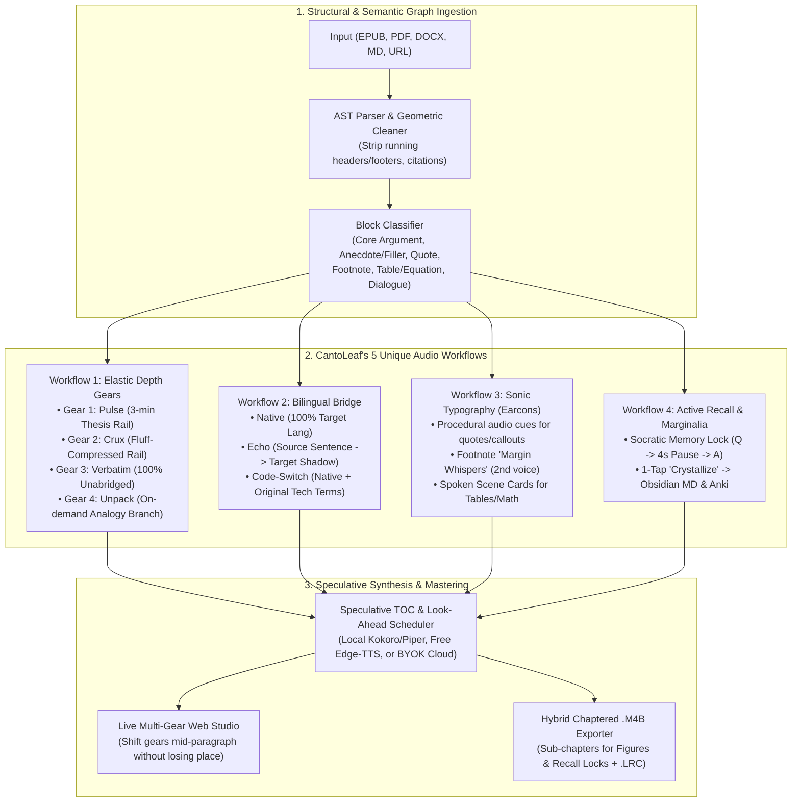

# CantoLeaf — Implementation Plan

> **Name Verification**: **CantoLeaf** (`whrizkey/cantoleaf`, CLI: `cantoleaf`) has **zero** existing matches on Google, GitHub, or PyPI (*Canto* = song/chant/epic division + *Leaf* = page of a book; alternatives also verified with zero collisions: **QuireCast**, **VellumCast**).
>
> **Vision**: Traditional eBook-to-audiobook tools (`ElevenReader`, `Speechify`, `voxbook.app`, `ebook2audiobook`, `abogen`) treat books as flat linear text dumps—forcing listeners onto a single rail where they either zone out during fluff, get lost in tables/footnotes, or lose the original terminology when translating.
>
> **CantoLeaf** is an open-source, **BYOK + Local-First Cognitive Audio Reader & Audiobook Studio** built around how humans actually acquire knowledge from books. Instead of just reading raw text aloud, it introduces **five never-before-used audio workflows** while remaining 100% open-source, offline-capable, and cost-protected.

---

## 0. Instructions for the Implementing Agent

1. **Private Repo First**: Create the GitHub repository (`whrizkey/cantoleaf`) as **private** (`private: true`) before pushing any commits.
2. **Milestone Order**: Execute strictly in order (`M0 → M9`). A milestone is done only when all acceptance criteria and automated tests pass. Commit and push at the end of every milestone.
3. **Strict Provider Abstraction**: Every external or local model service (TTS, LLM Adaptation/Translation, OCR) sits behind a typed `Protocol` (Section 5). Never call a vendor SDK directly from parser, pipeline, or UI code.
4. **Secret Hygiene**: Never commit API keys, never log them, and automatically redact them in error traces. Store keys via OS keyring (`keyring`) or gitignored `.env`.
5. **100% Offline Testability**: Every provider protocol includes a deterministic `fake` implementation so the entire test suite (`pytest`) runs offline in CI with zero API keys or GPU hardware.
6. **Code Quality**: Python 3.11+, packaged with `uv`, linted/formatted with `ruff`, and strictly type-checked with `mypy --strict`.
7. **Living Docs**: Record design trade-offs in `docs/DECISIONS.md` and keep `README.md` and `CHANGELOG.md` accurate at every milestone.

---

## 1. Five Never-Used-Before Workflows (What Sets CantoLeaf Apart)

Every existing TTS reader feeds `Book → Sentences → TTS → MP3/Stream`. **CantoLeaf** replaces that flat pipeline with a **Multi-Rail Cognitive Audio Graph**:



### Workflow 1: Elastic Depth Gearshifting ("Zoom-Lens Listening")
When reading with your eyes, you skim anecdotes, read core arguments at normal speed, and pause to unpack dense equations. In existing audiobooks, you are trapped at one density.
- **How it works**: Every chapter is indexed by paragraph (`block_index`) across **four synchronized density rails**:
  1. **`Gear 1 — Pulse` (3-Minute Skim Rail)**: Synthesizes only core thesis claims and section transitions.
  2. **`Gear 2 — Crux` (High-Signal / No-Fluff Rail)**: Reads the author's primary arguments verbatim, but automatically replaces multi-page repetitive anecdotes or filler case studies with a 1-sentence spoken bridge (*"[Skimming 2 pages of the 1998 airline anecdote: checklists cut errors by 40%.]"*).
  3. **`Gear 3 — Verbatim` (Unabridged Rail)**: 100% faithful word-for-word narration of the book.
  4. **`Gear 4 — Unpack` ("Wait, Explain That" Branch)**: Triggered on-demand in the player (or auto-attached to high-density equations/jargon): branches into a 30-second plain-language breakdown with an everyday analogy before returning to the exact sentence in the book.
- **Seamless Mid-Chapter Gearshift**: Because every utterance in `Pulse`, `Crux`, and `Verbatim` is anchored to its source `block_index`, dragging the **Depth Gearshift** slider from `Pulse` to `Verbatim` mid-listen transitions smoothly at the end of the current sentence into the exact corresponding paragraph of the book!

### Workflow 2: The "Bilingual Bridge" (4-Mode Cross-Language Weaving)
Instead of a binary "Original vs. 100% Translated" switch, CantoLeaf introduces four cross-language listening modes (`--lang-mode`):
1. **`verbatim-source`**: Original language.
2. **`native-target`**: Context-aware narrative translation into the target language (`--to <lang>`) with a locked terminology glossary.
3. **`echo` (Shadow-Listening / Assimil Mode)**: Alternates sentence-by-sentence: **Voice A** speaks the original sentence (e.g., English or Japanese), followed immediately by **Voice B** speaking the translated sentence (e.g., Indonesian or Spanish)—turning any book or paper into an effortless dual-language immersion course.
4. **`code-switch` (Technical Diglot Mode)**: Translates the surrounding prose into the listener's native language while keeping domain-specific technical terms, key concepts, and proper nouns in the original language (with a brief inline gloss on first occurrence).

### Workflow 3: Sonic Typography & Procedural Earcons (Hearing Layout Without Robotic Clutter)
Instead of saying *"Quote... End quote... Footnote 4... Table row 1..."*, CantoLeaf renders visual book structure into **acoustic typography** (`pipeline/earcons.py`):
- **Procedural Earcons (Zero external audio files)**: Pure `numpy` synthesized micro-chimes, subtle stereo positioning, and gentle EQ warmth shifts indicate structural transitions (headings, blockquotes, callout boxes, code blocks).
- **Footnote "Margin Whispers"**: Short, high-value footnotes are spoken inline at natural clause breaks by a slightly softer, stereo-offset secondary voice (*aside style*), while bibliographic citation footnotes are automatically silenced.
- **Visual-to-Audio Scene Cards**: Tables, charts, and equations are converted into concise **Spoken Figure Cards** bracketed by a subtle earcon and tagged as skippable sub-chapters in `.m4b` exports so listeners can skip any table with a single "Next Chapter" tap on their headphones.

### Workflow 4: Active Recall Checkpoints ("Memory Locks") & Spoken Marginalia
To solve the #1 problem of audiobooks—*listening for an hour and remembering nothing*:
- **Socratic Memory Locks (`--recall-locks`)**: At the end of each chapter (or major section), CantoLeaf optionally appends a 45-second interactive audio checkpoint:
  - Asks 2–3 targeted retrieval questions on the chapter's core mental models.
  - Inserts a **4-second thinking pause** with a soft ambient pulse so the listener actively recalls the answer while walking or driving.
  - Speaks the concise answer before advancing to the next chapter.
- **1-Tap "Crystallize" (Spoken Marginalia $\rightarrow$ Obsidian / Anki)**: Pressing `C` in the player (or CLI bookmark) captures the current paragraph context, distills the key insight + quote + exact chapter/timestamp citation, and exports it directly to a local **Markdown Knowledge Vault (Obsidian-compatible)** and a **Spaced-Repetition Deck (`.csv` / Anki-ready)**.

### Workflow 5: Speculative TOC Pre-Warming & Hybrid `.m4b` Mastering
- **Instant Jump Anywhere (`< 50 ms`)**: When a book is opened in `listen` mode, the scheduler doesn't just buffer ahead of sentence #1—it speculatively synthesizes the **first 2 sentences of every chapter in the Table of Contents** plus the **Gear 1 (`Pulse`) rail**, so clicking *any* chapter or skimming the book plays instantaneously while the rolling look-ahead window fills in behind it.
- **Custom Recipe `.m4b` Export**: Users can export standard unabridged `.m4b` audiobooks, or **Hybrid `.m4b` Editions** (e.g., *"Export Chapters 1, 3, 5 in `Verbatim`, Chapters 2, 4, 6 in `Crux` (no-fluff), and embed Socratic Memory Locks between chapters"*), complete with cover art, sub-chapter markers for figures/recalls, and synchronized `.lrc`/`.srt` read-along tracks.

---

## 2. Tech Stack & Architectural Decisions

| Concern | Choice | Notes |
|---|---|---|
| **Language & Packaging** | Python 3.11+ with `uv` (`pyproject.toml`) | Fast reproducible lockfiles, clean CLI entrypoint (`cantoleaf`). |
| **Document Ingestion** | `ebooklib` + `beautifulsoup4` (EPUB/HTML), `pymupdf` (PDF/MOBI/FB2), `python-docx` (DOCX), Markdown/TXT/URL extractors | Bounding-box awareness in PDFs strips running headers/footers geometrically. |
| **Local / Free TTS** | `kokoro-onnx` (Apache-2.0 82M local neural TTS), `piper-tts` (fast CPU offline), `edge-tts` (zero-key neural voices + native `WordBoundary` timestamps) | Works out-of-the-box with $0 API cost. |
| **BYOK Cloud TTS** | `elevenlabs` (with `/with-timestamps` alignment), `openai_compat` (OpenAI, Groq, Kokoro-FastAPI, LocalAI, DeepInfra) | Pluggable behind `TtsProvider` protocol. |
| **LLM Adaptation & Translation** | `openai_compat` (OpenAI, local Ollama, LM Studio, Groq, OpenRouter, DeepSeek), `anthropic`, `deepl` | Powers Gear 1/2/4 depth rails, Bilingual Bridge, Table narration, and Socratic Recall Locks. Graceful rule-based extractive fallback when no LLM is configured! |
| **Procedural Earcons & DSP** | `numpy` + `soundfile` + `ffmpeg` | Generates warm harmonic earcons, stereo margin whispers, silence pacing, and `.m4b` AAC mastering. |
| **Cache & Persistence** | `sqlite3` (WAL mode) + content-addressed WAV/alignment store | Keyed by `(text_hash, provider, voice, rate, earcon_profile)`—never pays twice for the same sentence. |
| **UI / Frontends** | **CLI (`typer` + `rich`)** + **Local Web Studio (`FastAPI` + responsive Read-Along SPA)** | Self-contained web studio (`cantoleaf serve`) with live Depth Gearshift slider, word-by-word highlighting, Bilingual Bridge toggle, and 1-click Crystallize note drawer. |

> [!IMPORTANT]
> **Zero-LLM Graceful Fallback**: What if a user has *zero* LLM API keys and isn't running Ollama? Every workflow still works offline! `Gear 1 (Pulse)` and `Gear 2 (Crux)` fall back to deterministic **TextRank / TF-IDF Position-Weighted Extractive Summarization** (picking topic sentences and high-centrality paragraphs), `Sonic Typography` uses structural HTML/PDF tags directly, and `TTS` uses local `Kokoro`/`Piper` or free `edge-tts`.

---

## 3. Repository Structure

```text
cantoleaf/
├── pyproject.toml
├── README.md
├── LICENSE                        # Apache-2.0
├── .env.example
├── pricing.toml                   # Editable provider token/char pricing table
├── .gitignore
├── .github/
│   ├── workflows/ci.yml           # ruff, mypy --strict, pytest on Ubuntu/macOS/Windows
│   ├── ISSUE_TEMPLATE/{bug_report.md,feature_request.md}
│   └── pull_request_template.md
├── docs/
│   ├── ARCHITECTURE.md
│   ├── DECISIONS.md
│   ├── PROVIDERS.md
│   ├── WORKFLOWS.md               # Deep dive into the 5 CantoLeaf workflows
│   └── CONTRIBUTING.md
├── src/cantoleaf/
│   ├── __init__.py
│   ├── __main__.py                # python -m cantoleaf
│   ├── cli.py                     # Typer CLI (listen, convert, brief, crystallize, estimate, doctor, serve, cache)
│   ├── config.py                  # Pydantic settings + OS keyring integration
│   ├── models.py                  # Frozen dataclasses: Book, Chapter, SemanticBlock, Utterance, DepthGear, ...
│   ├── errors.py                  # Typed exceptions + automatic secret redaction
│   ├── ingest/
│   │   ├── registry.py            # Format detection & parser dispatch
│   │   ├── epub.py                # EPUB 2/3 spine, TOC, footnotes, cover extractor
│   │   ├── pdf.py                 # PyMuPDF bbox extraction & geometric header/footer stripping
│   │   ├── docx_md.py             # DOCX, Markdown, TXT, HTML parsers
│   │   ├── web.py                 # Clean article extractor for URLs
│   │   ├── cleaner.py             # De-hyphenation, citation/URL stripping, prosody normalization
│   │   ├── classifier.py          # Tags blocks: CORE, ANECDOTE, QUOTE, FOOTNOTE, TABLE, EQUATION, CODE
│   │   └── segmenter.py           # Abbreviation- & CJK-safe sentence splitter with char offsets
│   ├── providers/
│   │   ├── base.py                # Protocols: TtsProvider, AdaptProvider (LLM/Extractive), TranslateProvider
│   │   ├── registry.py            # Provider discovery, capability matrix, health check
│   │   ├── tts/
│   │   │   ├── kokoro_local.py    # Offline Kokoro-ONNX provider
│   │   │   ├── piper_local.py     # Offline Piper provider
│   │   │   ├── edge.py            # Microsoft Edge TTS + native WordBoundary timestamps
│   │   │   ├── elevenlabs.py      # ElevenLabs API + character/word timestamp alignment
│   │   │   ├── openai_compat.py   # OpenAI / Groq / Kokoro-FastAPI / LocalAI TTS
│   │   │   └── fake.py            # Deterministic sine-wave + synthetic word timings
│   │   └── adapt/
│   │       ├── extractive.py      # Zero-LLM local extractive adapter (TF-IDF + position heuristics)
│   │       ├── openai_compat.py   # LLM Depth Gear generator, Translator, Table narrator, Socratic Recall
│   │       ├── anthropic.py       # Claude adapter
│   │       ├── deepl.py           # DeepL translation adapter
│   │       └── fake.py            # Deterministic offline mock adapter
│   ├── workflows/
│   │   ├── depth_gears.py         # Workflow 1: Builds Pulse (G1), Crux (G2), Verbatim (G3), Unpack (G4) rails
│   │   ├── bilingual_bridge.py    # Workflow 2: Native, Echo (interleaved), and Code-Switch weavers
│   │   ├── earcons.py             # Workflow 3: Procedural numpy earcons, margin whispers & scene cards
│   │   └── retention.py           # Workflow 4: Socratic Memory Locks & Obsidian/Anki Crystallizer
│   ├── pipeline/
│   │   ├── synthesizer.py         # TTS execution, silence trim, 3-tier WordTiming aligner, earcon mixing
│   │   ├── scheduler.py           # Workflow 5: Speculative TOC pre-warmer + rolling look-ahead + gearshift sync
│   │   ├── accounting.py          # Pre-flight chapter cost estimator & hard USD spend cap
│   │   └── cache.py               # SQLite WAL + content-addressed audio/alignment store
│   ├── export/
│   │   ├── m4b.py                 # Hybrid & standard chaptered .m4b builder (with Figure/Recall sub-chapters)
│   │   ├── mp3_zip.py             # Chapter MP3/Opus bundle exporter
│   │   ├── lyrics.py              # Synced .lrc, .srt, .vtt, and multi-gear JSON manifest
│   │   └── vault.py               # Obsidian Markdown + Anki CSV/deck exporter for Crystallized notes
│   └── web/
│       ├── app.py                 # FastAPI studio server + SSE/WebSocket live status
│       └── static/                # Responsive Read-Along UI with Depth Gearshift slider & Bilingual view
└── tests/
    ├── unit/
    ├── integration/
    ├── fixtures/
    └── conftest.py
```

---

## 4. Core Data Models (`models.py`)

```python
class DepthGear(StrEnum):
    PULSE = "pulse"  # Gear 1: ~10% length (Thesis & key takeaways rail)
    CRUX = "crux"  # Gear 2: ~55% length (Core arguments verbatim, anecdotes bridged)
    VERBATIM = "verbatim"  # Gear 3: 100% length (Unabridged cleaned text)
    UNPACK = "unpack"  # Gear 4: On-demand plain-language analogy/explanation branch


class BlockKind(StrEnum):
    HEADING = "heading"
    PROSE = "prose"
    ANECDOTE = "anecdote"
    QUOTE = "quote"
    FOOTNOTE = "footnote"
    TABLE = "table"
    EQUATION = "equation"
    CODE = "code"
    RECALL_LOCK = "recall_lock"


class LangMode(StrEnum):
    SOURCE = "source"  # Original language
    TARGET = "target"  # Full target language translation
    ECHO = "echo"  # Interleaved: Source sentence (Voice A) -> Target sentence (Voice B)
    CODE_SWITCH = "code_switch"  # Target prose with original domain terminology preserved


@dataclass(frozen=True)
class Utterance:
    utterance_id: str  # f"{book_id}:ch{ch}:b{blk}:{gear}:{lang_mode}:u{idx}"
    chapter_index: int
    block_index: int  # Shared anchor across all DepthGears for seamless mid-chapter gearshifting!
    gear: DepthGear
    lang_mode: LangMode
    block_kind: BlockKind
    source_text: str
    spoken_text: str
    voice_role: str = "primary"  # "primary" | "secondary_echo" | "margin_whisper" | "socratic_host"
    earcon_before: str | None = (
        None  # "chime_heading" | "warm_quote_in" | "figure_card" | "recall_bell"
    )
    earcon_after: str | None = None
    pause_after_ms: int = 350
```

---

## 5. Detailed Design of the 5 Workflows

### 5.1 Block Anchor Synchronization for Depth Gearshifting (`workflows/depth_gears.py`)
How can a user drag the gearshift from `Pulse` (Gear 1) to `Verbatim` (Gear 3) at minute 01:45 of Chapter 4 without losing their place?
- Every `SemanticBlock` in a chapter has a monotonic `block_index` ($0, 1, \dots, N-1$).
- In **`Verbatim` (Gear 3)**, block $k$ produces utterances $U_{k,0}, U_{k,1}, \dots$ all tagged with `block_index = k`.
- In **`Crux` (Gear 2)**, if block $k$ is classified as `PROSE (Core)`, it shares the exact same utterances (and reuses the exact same cached audio!) as `Verbatim`. If blocks $k \dots k+4$ are classified as a lengthy `ANECDOTE`, `Crux` replaces them with a single bridge utterance anchored to `block_index = k`.
- In **`Pulse` (Gear 1)**, each section of blocks $[k_{\text{start}}, k_{\text{end}}]$ produces 1–2 synthesis utterances anchored to `block_index = k_start`.
- **Result**: When the listener shifts gears while listening to an utterance with `block_index = k`, the player finishes the current sentence and immediately queues the new gear's utterance at `block_index >= k`. Zero lost context, and `Crux`/`Verbatim` share cached audio for all core paragraphs!

### 5.2 Procedural Earcons & Margin Whispers (`workflows/earcons.py`)
All acoustic typography cues are synthesized mathematically using `numpy` at 24 kHz so there are no external sound files to bundle:
- **`chime_heading`**: Soft two-note fifth interval ($440\text{ Hz} \rightarrow 659.25\text{ Hz}$) with exponential decay ($180\text{ ms}$, $-18\text{ dBFS}$) before chapter/section titles.
- **`warm_quote_in` / `warm_quote_out`**: Subtle $90\text{ ms}$ low-pass filtered resonant pluck signaling entry/exit of a blockquote or epigraph.
- **`figure_card`**: Soft triad arpeggio ($220\text{ ms}$) marking the start of a narrated Table, Chart, or Equation summary.
- **`recall_tick`**: During the 4-second thinking pause of a Socratic Memory Lock, a gentle $-26\text{ dBFS}$ soft pulse once per second so the listener knows playback is active while they think of the answer.
- **`margin_whisper` (Footnotes)**: Gently attenuates high frequencies above $6\text{ kHz}$ and reduces gain by $-3.5\text{ dB}$ with a secondary voice so inline footnotes sound distinctly like a helpful side-commentary.

### 5.3 3-Tier Word Highlighting Synchronization (`pipeline/synthesizer.py`)
1. **Native Timestamps**: Extracted directly from `edge-tts` (`WordBoundary` events) and `elevenlabs` (`/with-timestamps` character alignment).
2. **ONNX Phoneme Alignment**: Derived from local `kokoro-onnx` / `piper` duration predictors where exposed.
3. **Syllable- & Punctuation-Weighted Interpolation**: Because every sentence (`Utterance`) is synthesized individually, sentence boundaries have **0.0 ms cumulative drift** across a 20-hour book. Within each 3–8 second sentence, word timings are interpolated proportionally to syllable count + clause punctuation pauses.

---

## 6. CLI Interface (`cli.py`)

```bash
# 1. System & provider diagnostics
cantoleaf doctor

# 2. Pre-flight book inspection: chapters, block types, durations per Gear, and BYOK API cost estimate
cantoleaf estimate <file|url> [--gear pulse|crux|verbatim] [--lang-mode source|target|echo|code_switch] [--to <lang>]

# 3. Live Read-Along Listener (starts local Web Studio or terminal stream with Speculative TOC pre-warming)
cantoleaf listen <file|url> [--gear crux] [--lang-mode echo] [--to id] [--tts kokoro|edge|elevenlabs|openai]

# 4. Convert to Chaptered .M4B (supports single gear or Hybrid recipes + Socratic Recall Locks)
cantoleaf convert <file|url> --out <book.m4b> \
    [--gear verbatim|crux|pulse] \
    [--lang-mode source|target|echo|code_switch] [--to <lang>] \
    [--recall-locks] [--earcons] [--bilingual-subs]

# 5. Crystallize highlights/ranges into Obsidian Markdown notes & Anki flashcards
cantoleaf crystallize <file|url> --chapter 3 [--block-range 10-25] --vault ./notes

# 6. Launch the full Interactive Web Studio (Bookshelf + Multi-Gear Player + Crystallize Drawer)
cantoleaf serve [--host 127.0.0.1] [--port 8420]

# 7. Voices, Providers & Cache management
cantoleaf providers list
cantoleaf voices list [--tts ...] [--lang ...]
cantoleaf cache info | clear | prune --max-gb 5
```

---

## 7. Milestones (`M0 → M9`)

### M0 — Private Repository Bootstrap & System Diagnostics
- **Tasks**:
  - Create private GitHub repository (`whrizkey/cantoleaf`, `private: true`).
  - Commit `IMPLEMENTATION_PLAN.md`, `pyproject.toml` (`uv`), `ruff` & `mypy --strict` config, `.gitignore`, `LICENSE` (Apache-2.0), `.env.example`, `pricing.toml`.
  - Configure `.github/workflows/ci.yml` (lint, strict type-check, pytest across Linux, macOS, Windows).
  - Implement `config.py`, `errors.py` (with secret redaction filter), `models.py`, and `cantoleaf doctor`.
- **Acceptance Criteria**:
  - `uv run ruff check`, `uv run mypy src`, and `uv run pytest` pass 100%.
  - `uv run cantoleaf doctor` verifies Python, `ffmpeg`, `ffprobe`, audio output, and provider readiness.

### M1 — Structural AST Ingestion, Geometric PDF Cleaner & Block Classifier
- **Tasks**:
  - Implement parsers for `.epub`, `.pdf` (with geometric top/bottom 7% repeating header/footer rejection), `.docx`, `.md`, `.txt`, `.html`, and web URLs.
  - Implement `cleaner.py` (de-hyphenation, citation/URL stripping, number/abbreviation expansion).
  - Implement `classifier.py` (tags blocks as `HEADING`, `PROSE`, `ANECDOTE`, `QUOTE`, `FOOTNOTE`, `TABLE`, `EQUATION`, `CODE`) and `segmenter.py` (multilingual sentence splitter with exact character offsets).
- **Acceptance Criteria**:
  - `cantoleaf estimate <fixture>` outputs chapter breakdown, block-type counts, estimated duration for all 3 gears (`Pulse`, `Crux`, `Verbatim`), and zero running header/footer leakage on multi-page PDF fixtures.

### M2 — Provider Protocols, Fake Providers, Local/Free TTS & Extractive Adapter
- **Tasks**:
  - Implement `TtsProvider` and `AdaptProvider` protocols in `providers/base.py` plus `registry.py` and `accounting.py` (pre-flight cost estimator + `CANTOLEAF_MAX_COST_USD` circuit breaker).
  - Implement deterministic `fake` providers for offline testing.
  - Implement `extractive.py` (zero-LLM local TF-IDF/position extractive adapter so `Pulse`, `Crux`, `Unpack`, and `Recall Locks` work 100% offline without any LLM key!).
  - Implement local/free TTS providers: `edge.py` (with native `WordBoundary`), `kokoro_local.py` (`kokoro-onnx`), and `piper_local.py`.
- **Acceptance Criteria**:
  - Parametrized provider contract tests pass offline.
  - `cantoleaf voices list` and `cantoleaf providers list` report usable providers and voices.

### M3 — Workflows 1 & 2: Elastic Depth Gears & Bilingual Bridge
- **Tasks**:
  - Implement `workflows/depth_gears.py`: generates `Pulse` (Gear 1), `Crux` (Gear 2), `Verbatim` (Gear 3), and on-demand `Unpack` (Gear 4) utterance streams with shared `block_index` anchors.
  - Implement `workflows/bilingual_bridge.py`: builds `SOURCE`, `TARGET`, `ECHO` (interleaved dual-voice sentence shadowing), and `CODE_SWITCH` (native prose + preserved original domain terms) streams.
  - Implement LLM adapters (`openai_compat.py`, `anthropic.py`, `deepl.py`) with JSON schema validation, retry/repair, and glossary support.
- **Acceptance Criteria**:
  - Unit tests verify that shifting from `Pulse` $\rightarrow$ `Crux` $\rightarrow$ `Verbatim` at any `block_index` resumes at the exact target block without repeating or skipping core paragraphs.
  - `ECHO` mode interleaves `primary` (source lang) and `secondary_echo` (target lang) utterances in exact 1:1 correspondence.

### M4 — Workflow 3 & Synthesis Engine: Procedural Earcons, Word Sync & SQLite Cache
- **Tasks**:
  - Implement `workflows/earcons.py`: pure-numpy procedural generators for `chime_heading`, `warm_quote_in/out`, `figure_card`, `recall_tick`, and `margin_whisper` DSP filter.
  - Implement `pipeline/cache.py` (SQLite WAL + atomic content-addressed WAV/alignment cache).
  - Implement `pipeline/synthesizer.py` (24 kHz mono normalization, silence trimming, earcon mixing, and 3-tier `WordTiming` alignment).
- **Acceptance Criteria**:
  - Property-based tests (`hypothesis`) verify `WordTiming` monotonicity and zero drift across sentences.
  - Re-synthesizing or switching between `Crux` and `Verbatim` hits the SQLite cache 100% for shared core blocks.

### M5 — Workflow 4 & Exporters: Socratic Recall Locks, Crystallizer & Hybrid `.m4b`
- **Tasks**:
  - Implement `workflows/retention.py`: generates end-of-chapter Socratic Memory Locks (`Question → 4s recall_tick pause → Answer`) and `crystallize` extractor.
  - Implement `export/vault.py`: exports Crystallized insights to Obsidian Markdown notes (with book metadata + timestamp backlinks) and Anki `.csv` flashcards.
  - Implement `export/m4b.py`, `export/mp3_zip.py`, and `export/lyrics.py`: masters chaptered `.m4b` files with sub-chapter markers for Figures and Memory Locks, embedded cover art, and `.lrc`/`.srt` files.
- **Acceptance Criteria**:
  - `cantoleaf convert fixture.epub -o out.m4b --gear crux --recall-locks --earcons` produces a valid `.m4b` verified by `ffprobe` (chapters + sub-chapters + audio stream) plus synced `.lrc` and `.srt`.
  - `cantoleaf crystallize` produces valid Markdown and Anki CSV flashcards with accurate citations.

### M6 — Cloud BYOK TTS Providers (`ElevenLabs`, `OpenAI-Compatible`)
- **Tasks**:
  - Implement `elevenlabs.py` (supporting `/with-timestamps` character alignment and voice configuration) and `openai_compat.py` TTS (OpenAI, Groq, Kokoro-FastAPI, LocalAI).
  - Document all local and BYOK configurations in `docs/PROVIDERS.md`.
- **Acceptance Criteria**:
  - Mock HTTP tests verify timestamp alignment, `429` exponential backoff, budget cap enforcement, and secret redaction on errors.

### M7 — Workflow 5 & Web Studio: Speculative Scheduler & Interactive Read-Along UI
- **Tasks**:
  - Implement `pipeline/scheduler.py`: Speculative TOC pre-warming (first 2 sentences of every chapter + Gear 1 rail) + rolling look-ahead buffer + instant generation counter (`generation++`) on seek or gearshift.
  - Implement `web/app.py` (`cantoleaf serve` & `cantoleaf listen`):
    - **Bookshelf & Pre-Flight Cost Estimator Modal** (upload EPUB/PDF/DOCX/MD or paste URL).
    - **Multi-Gear Read-Along Player**: real-time word & sentence highlighting, live **Depth Gearshift Slider (`Pulse ↔ Crux ↔ Verbatim`)**, **Unpack This Paragraph** button, **Bilingual Bridge Selector (`Source | Target | Echo | Code-Switch`)**, playback speed (`0.5x–3.5x`), and audio earcon toggle.
    - **1-Click Crystallize Drawer**: saves current passage to Obsidian/Anki and lets users download the `.m4b` audiobook directly from the browser.
- **Acceptance Criteria**:
  - FastAPI integration tests cover upload, speculative TOC pre-warm, live gearshifting mid-chapter, `Unpack` branch generation, `Crystallize` export, and `.m4b` download.

### M8 — Stress Testing, Lexicon Overrides & Polish
- **Tasks**:
  - Add custom pronunciation dictionary support (`lexicon.toml`) for character names and acronyms.
  - Add `hypothesis` stress tests for rapid gearshifting + seek storms across chapters.
- **Acceptance Criteria**:
  - 30-operation random seek + gearshift storm completes with zero deadlocks, zero leaked tasks, and consistent cache state.

### M9 — Open-Source Launch Readiness (`v0.1.0`)
- **Tasks**:
  - Write comprehensive `README.md`, `docs/ARCHITECTURE.md`, `docs/WORKFLOWS.md`, `CONTRIBUTING.md`, and `CHANGELOG.md`.
  - Tag `v0.1.0` with green CI on the private repository, ready for public release whenever you choose.
